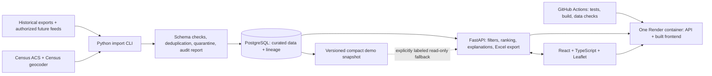
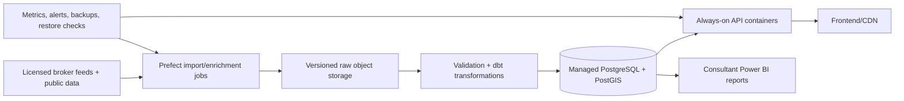

# LeaseSearcher: $0 client demo architecture

Design dated October 8, 2026; implementation added October 9. See README.md for the delivered behavior, setup and verified limits, and PROJECT_AUDIT.md for the original system and reproduced defects. The legacy Streamlit application remains unchanged during migration.

### Delivered demo and deferred design details

Implemented: React/TypeScript, FastAPI, explicit demo assumptions and optional strict eligibility, deterministic top-ten scoring, synchronized accessible map/list, Excel export, reproducible historical import, broker-review workbook, optional key-based ACS adapter, PostgreSQL/SQLAlchemy/Alembic, same-version snapshot fallback, JSON request logs, pytest/Vitest/Playwright, Docker/Compose and GitHub Actions configuration. Local API, actual PostgreSQL and browser checks have run. Docker and hosted CI/deployment still require verification outside this machine.

For the smallest usable release, the validated snapshot is the published artifact and PostgreSQL stores immutable snapshot documents; the normalized property/observation warehouse described below is a future evolution. There is no live feed, raw-wide Crexi adapter, automatic geocoding, tract/radius analysis, historical formula selector, dbt, Prefect or Power BI in this release. County population is labeled as a count, not density. Missing optional features remain neutral with coverage disclosure; no additional minimum optional-coverage cutoff is imposed. Site size is a hard overlap gate, then scores 100 for compatibility. Snapshot-only deployment requires no database account; the optional database path is tested with PostgreSQL 17. These concrete release choices take precedence over proposed details below.

## Decision and scope

Build an explainable restaurant-site screening demo with **TypeScript/React + FastAPI + PostgreSQL**, a reproducible Python data pipeline, and automated tests. Deploy one application container on Render's free web-service tier, with Supabase's free PostgreSQL for curated data. Support a local Docker Compose presentation as the reliable alternative when free hosting is sleeping or unavailable. No ML, accounts, favorites, alerts or saved searches.

Retain California coverage wherever usable data exists. Use Los Angeles County as the initial walkthrough, not a claim about the whole Los Angeles metro. The existing ranker has 95 distinct addresses in that county, versus 259 statewide. These are pre-validation counts, not verified restaurant-ready or currently available spaces; strict eligibility may reduce them substantially.

Product promise: **“Compare historical commercial listings against your restaurant preferences.”** The 2025 lease snapshot cannot support “all available listings” or current vacancy claims. Display “Listings collected September–December 2025; current availability unconfirmed” visibly. Label demographics with their separate survey vintage. Imports and website visits must not refresh a listing's verification date.

### Source review and confirmed constraints

The supplied [BUSA480 folder](https://drive.google.com/drive/u/0/folders/19WKEKsLDlMiSoPzOpAypvy4cACl-X7Bp) is accessible. I read its Final Presentation, introductory and midterm decks, Research Summary, raw Crexi wide-export schema and the subsequently supplied [SiteSelecterTran notebook](https://colab.research.google.com/drive/16bacmDlDPOSc8AGr1tr6GACjc55qBuXE). Notebook source was inspected without executing its cells. It loads the same six inputs as the application and contains preprocessing, scaling and scoring, but no reproducible creation of the manually prepared rent/area workbook or original scrape.

The notebook provides another scoring variant: site/location/competition **20%/40%/40%**, location ethnic/population/income **45%/35%/20%**, and site rent/size **60%/40%**. Competition subweights agree with the deck and application. Its notebook inputs use capitalized categories while the function checks lowercase values, so `High`/`Medium` would incorrectly fall into the low branch. It also shares the invalid demographic universe, missing income-code handling and constant-scaling defect. Register deck, notebook and app as explicit historical configurations; the documented final-deck preset remains the proposed baseline, not a claim that all sources agree.

The [Final Presentation](https://docs.google.com/presentation/d/1uOyZMrjkdAebD1ieZxTNXmcbnwbr-Z9w/edit) specifies site/location/competition defaults **40%/40%/20%**; site subweights **rent/size 50%/50%**; location **income/population/ethnic composition 30%/40%/30%**; competition **all competitors/same cuisine/price range 30%/50%/20%**. It also emphasizes parking and distinct walk-in versus pickup traffic needs. Those are business motivations, not measurements present in the existing Google restaurant data.

Important discrepancies: current UI defaults are site/location/competition **20%/40%/40%**; the deck says household income and population density, whereas code uses personal income and selected sample counts. The early deck's constant scores and midterm ML proposal are superseded by your current adjustable heuristic/no-ML scope. Its hierarchical output quotas are superseded by your requested single top-ten site list.

The additional [raw Crexi export](https://drive.google.com/file/d/1DsJfv7excrMawT7rQOGvjgyR7M7l0Pm6/view) has listing dates, zoning, power, parking and property type fields omitted by the cleaned file. They can be recovered through a documented adapter; a zoning code is not verified approval. Its schema still does not establish complete occupancy fees.

Updated decision (2026-10-10): the user superseded strict exclusion for the client demo. Assume listings exist and are restaurant-eligible, with visible labels and no fabricated verification. Use midpoint advertised rates and midpoint compatible offered sizes; divide annual rates by 12. Add disclosed monthly fees; undisclosed fees remain unknown and excluded. Missing usable rent, size, coordinates or source links still excludes a record. Keep strict policy available for a future verified product. ZIP-center substitution is disabled pending a separate decision.

## Architecture

The fallback is a small, immutable copy of the **same validated dataset version**, not a second ranker or live-data substitute. PostgreSQL is the system of record; fallback mode supports read-only demo searches if database startup fails. Health/metadata and the UI disclose snapshot mode and its date. Never silently switch dataset versions within a response. It does not bypass Render cold starts. Local Compose runs the same API, frontend build and PostgreSQL schema.

### Selected tools and their purpose

| Layer | Tools | Evidence you can demonstrate after implementation |
|---|---|---|
| UI | React, TypeScript, Vite, React Leaflet | Typed components, state management, accessible forms, synchronized map/list |
| API | FastAPI, Pydantic, Uvicorn, OpenAPI | Request validation, API contracts, error handling, dependency injection |
| Persistence | PostgreSQL, SQLAlchemy, Alembic | SQL, joins, constraints, indexes, transactions, schema migrations |
| Data | Python, pandas, HTTPX, deterministic CLI | ETL, provenance, idempotent loads, reproducible transformations |
| Verification | pytest, React Testing Library, Playwright | Unit, integration and end-to-end tests; actual UI interaction evidence |
| Delivery | Docker, Compose, GitHub Actions | Linux containers, CI, deployment automation, reproducible setup |
| Operations | Structured JSON logs, request IDs, health endpoints | Latency measurement, failure diagnosis, deployment checks |

These prioritize common SWE capabilities. SQLAlchemy, Alembic, typed API contracts and Playwright add depth without an unrelated language rewrite. Java/Spring Boot can be a separate learning project; duplicating this Python data engine in Java would delay the demo. dbt, Prefect and Power BI belong after the working demo if they solve a demonstrated need. AWS remains an optional future deployment path; do not list AWS deployment experience from this proposal alone.

## Data architecture

### Core schema

- **source / dataset_version:** provider, acquisition method, collection range, checksum, parser version, geography/survey vintage, publishing notes, pipeline run ID.
- **property / lease_space:** address, unit identity, coordinates, match precision, county/tract GEOID, floor-area range, property type and tri-state advertised restaurant suitability.
- **listing_observation:** source listing ID/URL, lease-space ID, observed rent value and unit, normalized monthly base rent, known additional fees, full-cost-known flag, observation/verification dates, availability status and raw-record reference.
- **restaurant_observation:** normalized restaurant identity, source date, cuisine tags and classification method, address, optional coordinates, review metrics. Reviews are not measured foot traffic.
- **area_demographics:** GEOID, geography type, survey vintage, estimates, margins of error and variable definitions. Never use ZIP as interchangeable with Census ZCTA.
- **area_features / scoring_config:** versioned market/competition features and normalization bounds; configuration identifying included components, weights and explanatory text.
- **pipeline_run / quarantine:** start/end state, row counts, error categories, accepted/rejected records and join coverage.

Use source IDs where available. An address is a property identifier candidate, not a unique lease-space identifier. Resolve units/ranges and preserve ambiguous matches for review instead of joining many-to-many. Foreign keys, uniqueness constraints and schema migration files make these rules inspectable. Add indexes for listing status, county, cost and space size; add PostGIS when radius queries actually ship.

### Reproducible ingestion

1. Keep original files unchanged and register checksums/provenance. The repository need not distribute the 95MB personal-record extract; publish the curated demo fixture and documented input acquisition instead.
2. Apply one adapter per file format/provider; validate required columns and types before transformation. Preserve postal codes as strings.
3. Parse rent into base value, unit and interval. Explicitly convert $/SF/year to monthly rate; distinguish building area, available space and individual suite area. Do not infer that an average area is a particular offered suite. Include the raw wide Crexi export adapter to preserve dates, zoning and parking; distinguish absent parking fields from explicitly unavailable parking.
4. Import the supplied 713-row wide Crexi source. Match original card rates/sizes by shared provider listing ID, with only unique normalized-address workbook matches as a labeled fallback. Do not construct listing URLs from image URLs. Retain conflicting rates as unknown and quarantine invalid records.
5. Reuse the existing geocode cache, then batch-geocode missing US addresses during ingestion. Store match status, precision, provider and benchmark. Validate California boundaries and ambiguous addresses; geocoding is not proof of parcel entrance or restaurant eligibility.
6. Replace distorted IPUMS aggregates with pinned Census ACS 5-year summary estimates. Start with county household-income/population metrics and density from compatible land-area data; use tract metrics only where geographic matching and estimates are adequate. A tract statistic is neighborhood context, not an exact walking catchment. Store population count and density separately and do not change labels without changing the underlying feature.
7. Classify cuisine deterministically with explicit categories and ambiguous/multiple tags. Missing category counts are zero only within documented observed coverage; insufficient source coverage is unknown.
8. Produce deduplication, exclusion and join-coverage reports. Load a staging dataset in a transaction, validate it, and publish atomically. Reimporting identical inputs/configuration produces the same IDs and features without duplicated observations.
9. Build the small read-only snapshot from the published dataset. Never load/clean raw workbooks or 1.85 million records during a recommendation request.

Launch uses a frozen snapshot with manually triggered, reproducible imports. No automatic lease refresh is promised without a usable feed. Future listing feeds can refresh weekly; ACS refresh is annual when a chosen release is available. Store “last import,” “last observed,” and “last verified” separately. A scheduled job cannot make an old export current.

The [Census API](https://www.census.gov/programs-surveys/acs/data/data-via-api.html) provides ACS summary estimates, and the [Census geocoder](https://geocoding.geo.census.gov/geocoder/Geocoding_Services_API.pdf) supports batch addresses and geographic lookup. Pin actual release/variable definitions rather than assuming an unavailable survey year. Match quality and missing cases must be measured during implementation.

## Ranking contract: heuristic, no ML

**First filter; then score.** Hard constraints include geography, known suitable size, normalized cost within the user budget, known required eligibility/fees, and explicit selected requirements. Unknown rent/required eligibility/fees are excluded under your rule. Availability is separate: unconfirmed historical listings may remain unless “Hide unconfirmed listings” is checked. If that removes everything, explain why and show no matches; never disable it secretly.

The scoring structure is **fit = w_site × site + w_location × location + w_competition × competition**, with each component bounded 0–100 and weights normalized to sum to one. Use the final deck's **40% site / 40% location / 20% competition** as the documented starting preset. Preserve its subweights listed above in a versioned baseline configuration. Coefficients are sourced from the final project deck, not newly validated by the client. Preserve an explicit legacy configuration for comparison, but correct data/statistical defects; do not present invalid old numbers as equivalent to corrected scores.

- **Site:** rent and desired-area match at 50% each, applied only after affordability and range constraints. Exclude unknown required costs instead of guessing them. Parking/readiness may be explicit requirements when evidence exists, but are not secretly assigned new scoring coefficients.
- **Competition:** observed total competitors, same-cuisine competitors and price range at 30%/50%/20%. Legacy directions favor fewer competitors and higher observed competitor prices; expose that assumption. A separately versioned future profile can model clustering or price-position match after client review. Initially counts are ZIP-based with source/coverage caveats; radius counts require restaurant coordinates and adequate coverage.
- **Location:** correctly defined household income, population/density and ethnic composition at the deck's 30%/40%/30%. Keep ethnicity enabled only when explicitly selected by the user, with a disable option and configuration-specific neutral treatment. Its 30% component share represents 12% of the total under default weights; this is a historical business assumption, not a research-estimated coefficient. “Asian share” cannot establish Vietnamese demand. No household-income-to-menu-price calibration is validated; use clear market-income preferences instead of asserting menu suitability.
- **Unknown optional features:** record missingness; use a fixed documented neutral value under one versioned score contract and expose coverage separately. Do not silently redistribute weights per listing or convert missing competition into “no competitors.” Require a minimum coverage threshold specified by the final formula.
- **Normalization:** freeze thresholds for a dataset/configuration version. Constant valid features are neutral 50. Monotonic cost behavior, deterministic tie-breaking by listing ID, finite values and score bounds are required. Filter changes must not secretly rescale scores.
- **Explanation:** return feature values, component scores, weighted contributions, missingness, geography level, source dates and configuration version. “Fit 82/100” means preference alignment, not 82% chance of success.

No training, MLflow, PyTorch, model serving or accuracy claims are justified here. Ranking validation is business-rule testing, sensitivity analysis and client review of example shortlists.

### Literature: how to treat ethnicity and demand

[Schiff, Cities and Product Variety](https://www.nathanschiff.com/dd_April_2014.pdf) finds associations between matching ethnic populations and cuisine presence, while population concentration and non-matching populations also matter. It studies cuisine availability, not the profitability of a proposed lease. Design inference: offer demographic context, avoid ethnicity-only recommendations, and do not choose score weights from this association alone.

[Athey et al., restaurant choices and travel time](https://arxiv.org/abs/1801.07826) studies Bay Area lunchtime choices using mobile-location observations and heterogeneous preferences. Design inference: travel friction and observed demand warrant attention, but this project has neither that visitation dataset nor validated travel-time features. Google review counts cannot substitute for footfall. Actual traffic, spending and drive-time analysis remain future enrichments.

The deck's formula remains the recognizable baseline while corrected measurements, explicit preference definitions and optional ethnicity make its limits inspectable. Literature does not calibrate these weights. Any changes to the client's intended criterion meanings will be versioned rather than silently embedded in code. Do not pre-prune to five counties and ten ZIPs before global ranking: that could discard otherwise strong sites; geographic summaries can explain the results without replacing the requested site-level top ten.

## API and user experience

### Endpoints

- `GET /api/v1/metadata`: cuisines, supported geography, input bounds, dataset/score version, collection dates, coverage and operating mode.
- `POST /api/v1/recommendations`: validated preferences, hard filters and weights; returns up to ten eligible mapped listings, source links, score breakdowns and counts explaining exclusions.
- `POST /api/v1/export.xlsx`: same search contract and dataset version; Excel workbook with rankings, evidence/warnings and methodology. Formula-like source text is written safely as text. Export must match the displayed search.
- `GET /health/live` and `/health/ready`: process health versus availability of a valid dataset; snapshot mode remains explicitly reported.

No public ingestion/admin endpoints. Read-only database credentials for the serving process; migrations/import credentials remain outside browser bundles. Bound request sizes and export row counts; use validated query parameters and parameterized SQL. A single origin serves frontend/API, avoiding an unnecessary CORS configuration.

### Screen flow

1. Visible historical-demo notice with collection dates and a short description of the score.
2. **Restaurant:** cuisine, service format if supported, desired area range and known-cost budget. Help text defines area/rent units with practical examples, not statistical jargon.
3. **Location:** California county/city filters and usable coverage counts. Initial walkthrough selects Los Angeles County; “all covered California areas” remains available.
4. **Priorities:** three understandable preferences with presets plus advanced weights. Explain normalized weights and which evidence affects each component.
5. **Results:** shared selected/hovered listing ID coordinates ten numbered Leaflet markers and ten cards. Hover/focus either highlights its counterpart; clicking works on touch devices. Ranking number, address, normalized rent/area, score, two strongest reasons, key uncertainties and source link appear consistently.
6. **Hide unconfirmed listings** plus Excel export. No results state distinguishes lack of coverage, strict unknown-data exclusions and filters that are too narrow.

Source link absence is visible as “source link unavailable”; never use a generic search link labeled as the original listing. To meet the requested map-and-source-link walkthrough, use listings with verified source identity and coordinates; account for excluded records in the report. Return fewer than ten if fewer are eligible. Do not hide missing locations by substituting city centroids without labeling them.

Use accessible focus states, keyboard selection, readable labels, responsive layout and a shared empty/error/loading state. Include score explanations and dates in Excel; prefer filters/frozen headers and separate methodology rather than a bare CSV.

## $0 deployment and reliability

- One multi-stage Docker build compiles the frontend and runs the Python API serving its built assets. Use explicit dependency locks and a pinned runtime; remove unrelated raw inputs and bytecode from the serving image.
- Supabase stores only curated listings, compact features and metadata; raw IPUMS does not consume the hosted database quota. Local PostgreSQL follows the same Alembic migrations.
- GitHub Actions runs lint/type checks, meaningful tests, migrations against ephemeral PostgreSQL, frontend build and a Playwright smoke journey. Dataset compilation uses workflow dispatch first; no operational refresh promise depends on scheduled CI.
- Runtime startup reads curated features once into an immutable dataset; bounded cached ranking by dataset version + validated input avoids repeated work. A deploy publishes a new version; no runtime file writes are required for serving.
- Structured logs include request ID, dataset/configuration version, status, timing and exclusion counts. Do not log secrets. Show retriable service errors and keep user inputs intact.
- Target, not measured result: warm recommendation p95 ≤1s for 10 concurrent demo users; Excel ≤3s; no ranking-time external calls; startup/load failure explicit. Benchmark the actual free instance before quoting achieved performance. No paid-production SLA on free tiers.

[Render free services](https://render.com/docs/free) currently sleep after 15 minutes of inactivity and can take about a minute to wake; filesystem changes are ephemeral. [Supabase free pricing](https://supabase.com/pricing) currently includes a 500MB database and pauses inactive projects; [pausing documentation](https://supabase.com/docs/guides/platform/free-project-pausing) describes the activity policy. A presenter should restore the DB if needed and open the demo before the meeting. The local Compose demo is the fallback for internet/host failure. Do not promise always-on service for $0 or create artificial keep-alive traffic.

[GitHub Actions billing](https://docs.github.com/en/billing/concepts/product-billing/github-actions) provides free standard runners for public repositories and quotas for private repositories; use standard Linux runners and modest artifact retention. Keep paid features disabled. GitHub's [workflow-trigger documentation](https://github.com/github/docs/blob/main/content/actions/reference/workflows-and-actions/events-that-trigger-workflows.md) describes scheduled-workflow inactivity caveats; manual imports keep the demo honest.

Use attributed OpenStreetMap tiles within its [tile policy](https://operations.osmfoundation.org/policies/tiles/), with no bulk/offline tile download. Basemap failure must not prevent reading ranked listings. Store provider configuration so future production tiles can change.

## Implementation sequence and learning evidence

| Milestone | Deliverable | Learn and verify |
|---|---|---|
| 1. Data foundation | Encode reviewed deck formula; canonical fixtures; schema/migrations; reproducible import and exclusion report | SQL, relational modeling, transactions, parser design, provenance |
| 2. Backend | Typed API; pure versioned scorer; explanations; Excel export; health/logging | HTTP, REST, OpenAPI, validation, query design, unit/integration testing |
| 3. Frontend | React questionnaire, synchronized map/list, source links, filter states | TypeScript, components, state, accessibility, browser testing |
| 4. Demo delivery | Docker/Compose; CI; deployment instructions; benchmark report; presentation walkthrough | Containers, Linux, Git, CI/CD, debugging, measured performance |
| 5. Optional data depth | dbt feature marts/tests, Prefect refresh workflow, Power BI coverage/market report if useful | Incremental ETL, orchestration, lineage, analytical SQL and KPI definitions |

Implement the shortest complete vertical slice early: import a trustworthy fixture → filtered ranking → map/list → matching Excel. Expand coverage after the slice passes, not before. Preserve the existing Streamlit app and original files during migration; delete obsolete artifacts only once replacement behavior and provenance are verified. Automated tests can use clearly synthetic fixtures; never mix those with real recommended sites. A real-data demo will show an honest empty state until required evidence is supplied. No deadline/effort estimate is promised before source/eligibility constraints are resolved.

User actions needed for implementation/deployment: supply client-verified eligibility and complete-fee records for a real shortlist; connect the existing GitHub repository to a Render free account and create a dedicated Supabase free project if an account slot is available. Configuration belongs in local/deployment secrets, not chat or Git. AWS, a paid domain and deployment accounts are not needed to start local development. The notebook link has been supplied and reviewed.

### Acceptance gates

- No invalid income codes or unweighted sample-row “population” in the demo's demographic features.
- Every supported cuisine searches without crashing. Unsupported/low-coverage inputs are labeled, not fabricated.
- Constant/missing input handling, rent conversion, score bounds, deterministic ties and affordability exclusions tested.
- Duplicate input imports are idempotent; unit identity and joins cannot multiply spaces unnoticed.
- Missing usable rent/size/coordinates/links are excluded; assumed eligibility and unknown extra fees are labeled according to the finalized demo policy; unconfirmed availability filter works and can correctly return zero.
- Displayed list, mapped IDs, verified source links and exported IDs refer to the same snapshot/search; hover/focus/touch selection tested in a browser.
- End-to-end test exercises a meaningful search, map/card synchronization and workbook download; API integration tests use actual PostgreSQL, not only mocks.
- Bad input returns actionable validation; missing providers/DB cannot silently invent results. Cold-start limits and fallback mode are demonstrated.
- README documents setup, data dates/coverage, architecture, measured performance, methodology and tradeoffs; no unimplemented resume claims.

Potential resume statement after delivery, with measured values added only when verified: “Built a TypeScript/React and FastAPI site-selection demo backed by PostgreSQL; automated validated data imports, explainable ranking and Excel exports; containerized delivery with GitHub Actions and API/browser tests.” This project supports SWE and data-engineering evidence; it should not be presented as ML.

## Future improvements: consulting-company deployment

Start by funding trustworthy inventory, eligibility verification and local demand evidence. More infrastructure cannot repair stale or incomplete listings.

1. **First paid pilot:** always-on API, managed DB backups, verified feed, supervised data review, error monitoring and periodic restore tests. Keep one API service and one scheduled worker until load requires more.
2. **Multiple consultants/clients:** authenticated administrative ingestion/review, client-specific preferences and access controls, refresh monitoring and auditable approvals. Preserve the public no-login screening workflow if desired.
3. **Larger geographic coverage:** PostGIS spatial indexes, batch geocoding, licensed map/routing provider, incremental observations, regional feature marts and quantified coverage. [Supabase PostGIS](https://supabase.com/docs/guides/database/extensions/postgis) supports spatial queries; it does not supply missing competitors or footfall.
4. **Higher operational load:** separate worker/container scaling, durable job queues only when necessary, centralized metrics/tracing and tenant-aware caching. AWS ECS/RDS/S3 is an optional migration for procurement/control requirements, not a prerequisite for this demo.

### Planning budget, USD/month

These are allowances for modest usage, not provider quotations; exclude salaries, taxes, domains, professional verification and negotiated commercial-data contracts. Re-estimate from actual traffic, storage, refresh volume and provider quotes before purchase.

| Stage | Infrastructure allowance | Data/map allowance | Practical use |
|---|---:|---:|---|
| Historical demo | $0 within free quotas | $0 | Client walkthrough; sleeping hosts and unconfirmed old inventory |
| Small paid pilot | $50–150 | Quote required; initially reserve $100–500 | Always-on service, managed DB, modest batch enrichment |
| Small/mid consulting operation | $200–700 | Quote required; initially reserve $300–2,000+ | More clients/regions, worker jobs, monitoring, storage and richer data |

An actual current price anchor is [Supabase Pro](https://supabase.com/pricing), starting at $25/month; database compute, additional environments, PITR, API/maps and licensing can add costs. The allowance ranges above are design estimates and do not guarantee affordable nationwide commercial inventory. Spend primarily on coverage/verification before adding Kubernetes, streaming or a data warehouse.
