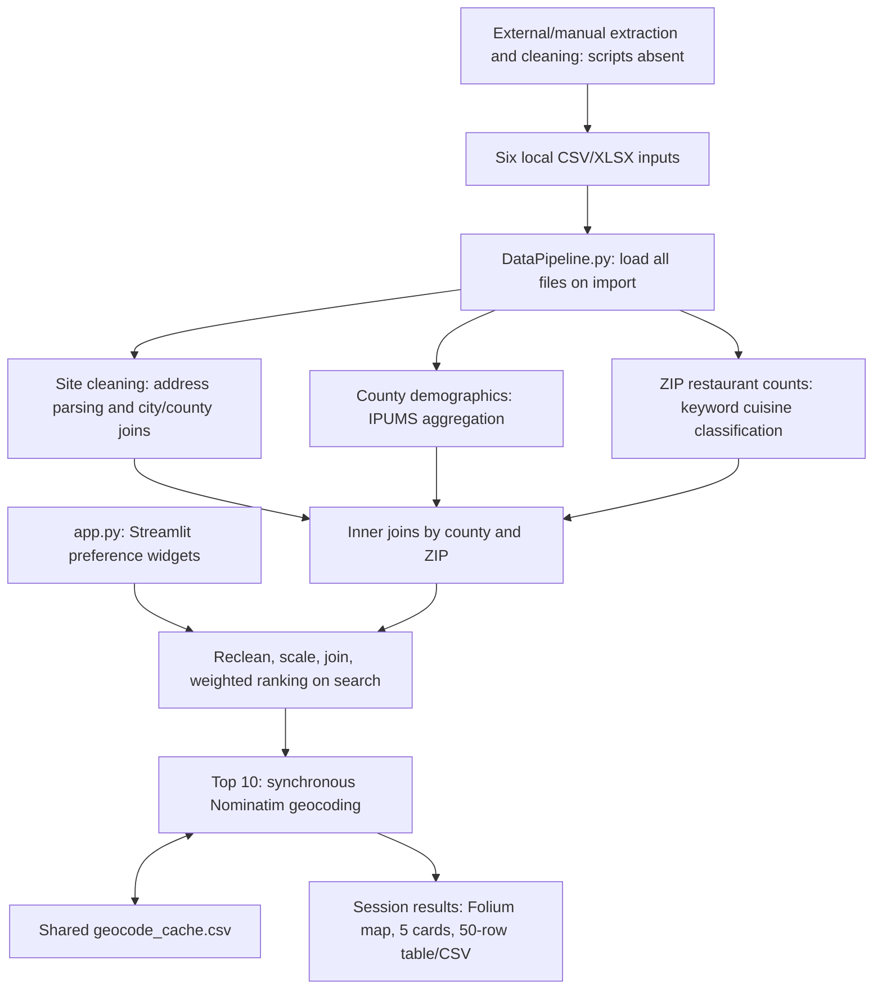

# LeaseSearcher: current architecture and clarification

Reviewed October 8, 2026. Application code unchanged. Findings combine source inspection and local pipeline execution; no live scraping or geocoding performed. Browser behavior and production performance have not been measured. No replacement architecture is finalized before your answers.

## Current architecture

- **UI and backend:** one Streamlit Python process; no separate React client or REST API. `app.py` manages inputs, session state, network calls and presentation.
- **Data preparation:** `DataPipeline.py`; pandas/NumPy plus `dictionaries.py` for county names and cuisine keywords. Initial UI cleaning is cached, but searches call cleaning again.
- **Recommendation:** configurable demographic/competition/site weights; fixed subweights; quantile categories, clipped scaling, size similarity. This is a heuristic ranker, not a trained model or success probability.
- **Persistence:** input files, a shared CSV geocode cache, and per-session memory. No database, durable saved searches, model registry, or job scheduler.
- **Environment:** unpinned `requirements.txt`; development container starts Streamlit. No README, automated tests, CI, production deployment configuration or ingestion scripts found in the tracked project.

| Input | Rows | Actual role |
|---|---:|---|
| CASitesForRent.xlsx | 902 | Main lease listings; 814 distinct addresses |
| CASitesForRent_with_averages.xlsx | 426 | Separate size/rent preparation; 375 distinct addresses |
| crexi-full-cleaned.csv | 427 | Loaded but never used in ranking |
| ca_restaurants_clean.csv | 37,526 | Existing restaurants; ZIP aggregation |
| usa_00026.csv | 1,853,429 | California person records, year 2023 only |
| California geography workbook | 619 | City-to-county lookup |

Cleaning produces 504 site rows across 280 addresses, 34 county rows and 1,373 ZIP rows. Final joins produce 483 rows across 259 addresses. Some repeated addresses could represent separate spaces; current identity rules cannot reliably distinguish legitimate units from duplicates.

## Major issues and adjustment targets

| Priority | Evidence | Consequence / adjustment target |
|---|---|---|
| P0 | `DataPipeline.py:103`: excludes income ≤20,000 before every demographic calculation; file lacks PERWT. 286,894 records have INCTOT=9,999,999, an unavailable code that passes this filter. | Demographics and income are distorted. Define statistical universes, missing codes and weighting; obtain suitable population estimates. |
| P0 | `DataPipeline.py:116`: group size is labeled population; only 2023 is present. | These are selected sample counts, not county population. UI labels such as rural/suburb/metro and foot-traffic claims lack supporting measurements. |
| P0 | `DataPipeline.py:195`: 18 selectable cuisines have no pivot column. Azerbaijani reproduces `KeyError`. | Supported inputs can crash search. Handle absent categories explicitly and distinguish unknown coverage from zero competition. |
| P0 | `DataPipeline.py:205,236`: constant-column fallback starts at 50, clips to 1, then multiplies by 100. Constant rent reproduces scaled score 100. | Supposed neutral values become extremes. Correct scaling and define empty, constant and missing-feature behavior. |
| P0 | Six static inputs; Crexi input unused; no freshness or collection workflow. | Cannot establish current availability or statewide completeness. Define source coverage, refresh, expiry and permitted acquisition. |
| P1 | Exact-address and city-name inner joins; later county/ZIP inner joins; 259/814 original distinct addresses retained. | Silent losses and possible row multiplication. Establish listing/unit identity, geographic identifiers and reconciliation counts. Lost addresses are not automatically invalid listings. |
| P1 | Import took ~7.9s on the first audit run; cleaning ~1.2–2.0s and repeated scoring ~1.2s. Geocoding is sequential with a one-second minimum delay, retries and ten-second timeout. | File loading and network work affect response time. Separate ingestion/enrichment from interactive search; benchmark cold/warm requests and concurrency. These timings are local, not production guarantees. |
| P1 | No rent ceiling, city/radius limit, restaurant-use eligibility or readiness filters. | High-scoring results may be unaffordable or unusable. Define hard constraints before preference ranking; normalize rent units and disclose unknown fees. |
| P1 | County attributes applied to individual sites; ZIP competition counts; keyword matching takes first substring match. | Coarse location proxies and ambiguous cuisine classification. Define trade areas, category confidence and evidence-backed explanations. Ethnic share is not a demonstrated demand model. |
| P1 | Population UI uses 30th/70th percentiles; ranking uses 25th/75th. Menu price is mapped to county personal income; every preference becomes a sharp binary score. | Inputs and results disagree; menu suitability claims exceed evidence. Align definitions and explain assumptions, tradeoffs and uncertainty. |
| P1 | CSV geocode writes have no locking/atomic persistence; failures are swallowed; failed addresses are retried indefinitely. Cache has 119 addresses, 14 without coordinates. | Concurrent sessions can overwrite results; failures lack diagnosis. Define durable cache, error state, retry limits and observability. A per-session limiter does not enforce a shared provider limit. |
| P1 | Unpinned dependencies; dev startup disables CORS and XSRF protection; no tests or CI. | Deployment lacks reproducibility and verification. Establish production configuration, automated checks, configuration/secrets management and health monitoring. |
| P2 | Extensive internal-DOM CSS, injected hover JavaScript, Folium component boundary; optional import failure is ignored before unconditional `st_folium` call. | UI integration is fragile. Verify actual browser behavior and implement supported interactions. Map/card synchronization is unverified. |
| P2 | Only 10/50 results are geocoded and 5 cards displayed; scores and reasons are omitted from export; raw names/addresses enter HTML without escaping. | Results are difficult to compare and audit. Align map/list/export, expose score components and source dates, and escape external text. Top 50 currently contains 47 distinct addresses. |

Other maintainability gaps: module-global DataFrames are mutated, transformations lack schema checks, source columns are selected by position, and file paths depend on the working directory. Repeated cleaning worked in this audit; mutation remains a coupling risk, not a reproduced repeat-call failure.

Source checks: [IPUMS INCTOT documentation](https://usa.ipums.org/usa-action/variables/inctot/ajax_enum_text) identifies 9,999,999 as unavailable; [IPUMS FAQ](https://usa.ipums.org/usa-action/faq) explains sample densities and person weights. [Nominatim policy](https://operations.osmfoundation.org/policies/nominatim/) governs shared limits and caching. Provider choice must account for intended workload.

## Clarification questions

Answer by number; “unsure” is fine. Questions **1, 2, 5, 7, 10, 19 and 20** drive the first design most directly.

1. Is the first release a recruiter portfolio/demo, a tool for an actual restaurant owner, or a public product?
2. What monthly budget covers hosting, listing data, maps/geocoding and APIs? Are paid data sources acceptable?
3. What deadline and how many hours per week can you invest? Must the demo stay available during migration?
4. Who will use it, and how many simultaneous users should the first release support? Mobile and language requirements?
5. Where did each input originate, when was it collected, and what access/reuse permission do you have? Where are the original extraction scripts, notebooks and cleaning instructions?
6. Can existing data be published in a public repository or demo? Are any files private or restricted?
7. Must launch cover all California, or can we validate one metro first? Does “all available” mean every commercial listing, or only plausible restaurant spaces from specified providers?
8. Which providers must be included? Do you have API access, broker feeds, accounts or permission to automate collection?
9. How fresh must listings be: daily, weekly or monthly? Should stale or unconfirmed listings remain visible with warnings?
10. Which criteria are mandatory: maximum total monthly occupancy cost, area range, city/radius, zoning, hood/ventilation, grease trap, parking, patio, alcohol eligibility, accessibility or second-generation restaurant space?
11. How should unknown rent, unknown eligibility and undisclosed fees be handled: excluded, shown with warnings, or separately ranked?
12. Which cuisines and service formats matter first? How should nearby competitors versus restaurant clusters influence desirability?
13. Is county/ZIP analysis acceptable initially, or do you require walking distance, drive time, local density and neighborhood analysis?
14. Should ethnicity remain an optional descriptive metric? What stronger demand evidence is available: foot traffic, customer research, daytime workers, delivery demand or spending?
15. What outcomes or labels exist for ML: successful openings, closures, revenue, user shortlists, expert judgments or owner feedback? Can you provide examples of good and bad recommendations?
16. What should recommendation quality mean and how will we validate it? Is an explainable heuristic baseline acceptable before trained ML?
17. Which features are needed at launch: map/list filters, site comparison, saved searches, favorites, CSV/PDF exports, listing links, availability alerts or an admin review queue?
18. Are sign-in, multiple users, persistent preferences and organization accounts required? Who may edit or approve questionable data?
19. Is the referenced shared stack acceptable: Python, TypeScript/React, FastAPI, PostgreSQL, pytest, Docker, GitHub Actions and AWS? Which existing technologies must stay? This is the prior plan's stack, not a finalized architecture.
20. Do you already have an AWS account, region preference, GitHub repository/admin access and domain? Would you prefer another deployment platform?
21. For MLE evidence, prioritize which outcome: ranking evaluation, experiment tracking/model serving, cuisine classification or listing extraction? Must PyTorch appear, or should we choose models based on evidence?
22. Should orchestration reuse Prefect? Do you want dbt and a Power BI dashboard after the core app, or alternatives?
23. What response-time and reliability targets matter? How should the app behave when a source/API is unavailable?
24. Do you want an incremental migration or replacement? Which existing behavior/design should be preserved, and may obsolete files/data be removed later?

## What you must provide or do

- Supply unavailable upstream scripts/notebooks and source metadata; this checkout cannot reveal how collaborators prepared the files.
- Establish provider permissions and supply authorized data access. I cannot independently establish complete California inventory or listing availability without source access.
- Provide business constraints, representative recommendations and any outcome labels. I can evaluate a ranker, but cannot invent reliable success labels.
- Complete account creation, billing and any interactive authentication required for deployment/providers. Keep credentials out of chat and Git; use local configuration or the eventual secret manager.

After clarification: propose the updated architecture, scope launch milestones and validation criteria, then implement in your requested priority order: SWE → MLE → Data Engineering → Data Analysis → Data Science.

## Follow-up after clarification

The user now specifies a $0 client demo, SWE learning first, no ML, top-ten map/list with synchronized highlights and real source links, Excel export, and no accounts. Unknown eligibility and complete fees must be strictly excluded, even if no sites remain. Availability remains separately filterable. See ARCHITECTURE_V2.md for the resulting design and paid future path.

BUSA480 source review reveals the final deck uses site/location/competition defaults 40%/40%/20%, while the app defaults are 20%/40%/40%. The deck intends household income and population density, not the code's personal income and sample counts. Its client interviews emphasize traffic/parking; the local restaurant CSV has review metrics rather than actual visitation observations. An additional raw Crexi wide export on Drive contains zoning, power, parking and listing dates omitted by the local cleaned file, but does not establish approvals or complete fees. No notebook appears in the supplied folder's direct children; its data_uncleaned shortcut target is unavailable in connector metadata.

The unused local Crexi file contains 427 real listing URLs. Preliminary normalized-address reconciliation matches 95 distinct cleaned addresses, requiring unit/source verification. Existing rankable addresses include 95 in Los Angeles County; this is a starting coverage count, not restaurant eligibility or current availability.

The supplied SiteSelecterTran.ipynb was subsequently inspected without execution. It uses the same six inputs and reproduces the major preprocessing/scaling assumptions; it does not establish missing approvals or complete fees. It adds a third scoring configuration: site/location/competition 20%/40%/40%, ethnic/population/income 45%/35%/20%, rent/size 60%/40%. Capitalized example categories also disagree with lowercase branch checks. These differences are now recorded in ARCHITECTURE_V2.md; the notebook is no longer an outstanding input.

## Approved demo update — 2026-10-10

The earlier strict-exclusion decision is superseded for the demo: assume listings exist and are restaurant-eligible, with visible labels. Advertised rate and compatible offered size ranges use midpoints. Undisclosed fees remain unknown and excluded from estimates. Missing usable rate, size, address coordinates or source links still exclude records. The wide Crexi import yields 708 accepted records from 713 rows, 244 parsed rents and 70 cached address locations. Original cards join by provider listing ID. ZIP-center substitution is disabled. Existing branding and layout are preserved.
